<p align="center"></p>

# The Portfolio

**Ideas. Interfaces. Shipped projects.**

[Visit portfolio](https://begoneeraj.github.io) · [Development](#development) · [Deployment](#deployment)

<table><tr><td width="33%" valign="top"><h3>Explore the work</h3><p>Project cards backed by a shared data module.</p></td><td width="33%" valign="top"><h3>Feel the motion</h3><p>Framer Motion, particles, and theme controls.</p></td><td width="33%" valign="top"><h3>Export and ship</h3><p>Next.js static output deployed to GitHub Pages.</p></td></tr></table>

The source for Pushpraj Singh Prashant's portfolio: an animated Next.js site covering background, skills, projects, and contact.

## Design and interaction

- **Motion:** Framer Motion transitions and a particle field component.
- **Theme:** Shared appearance controls through a theme provider.
- **Content:** Project and profile data in `src/lib/data.ts`.
- **Composition:** Separate hero, about, skills, projects, and contact components.

## Development

Use **Node.js 24** to match the deployment workflow.

```bash
git clone https://github.com/begoneeraj/begoneeraj.github.io.git
cd begoneeraj.github.io
npm ci
npm run dev
```

Open **http://localhost:3000**.

| Command | Purpose |
| :--- | :--- |
| `npm run dev` | Start development |
| `npm run lint` | Run ESLint |
| `npm run build` | Generate static output in `out/` |

## Customize

| Location | What to edit |
| :--- | :--- |
| `src/lib/data.ts` | Portfolio content |
| `src/components/` | Section UI and interactions |
| `src/app/page.tsx` | Page composition |
| `src/app/globals.css` | Global styles |
| `public/` | Public assets |

## Stack

Next.js 16 · React 19 · TypeScript · Tailwind CSS 4 · Framer Motion · Lucide

## Deployment

The GitHub Pages workflow runs on pushes to `main` and manual dispatch. It installs dependencies, builds, uploads `out/`, and deploys that artifact.

`next.config.ts` enables static export and unoptimized images. Preview an export locally with:

```bash
npm run build
npx serve out
```
